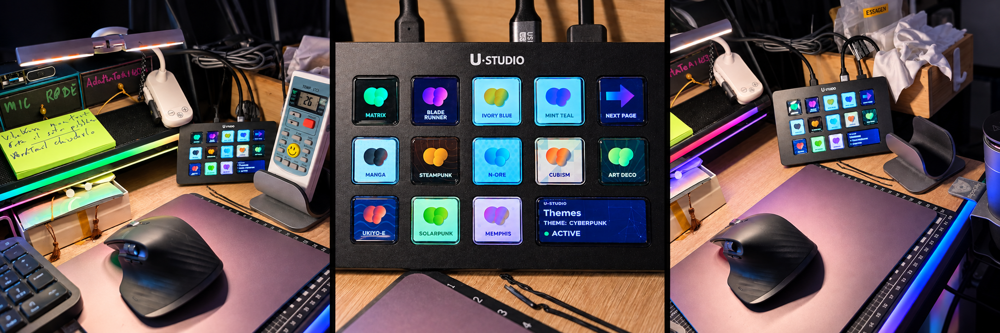
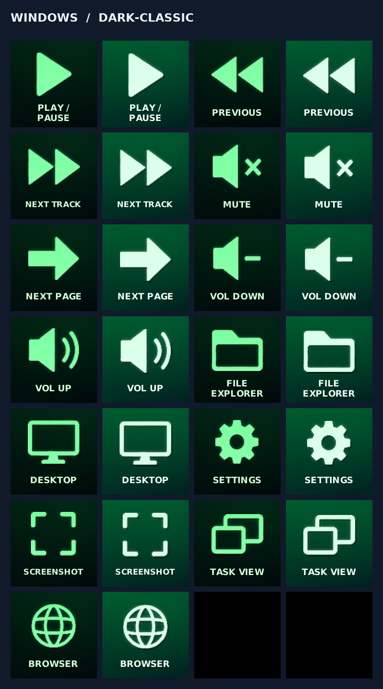
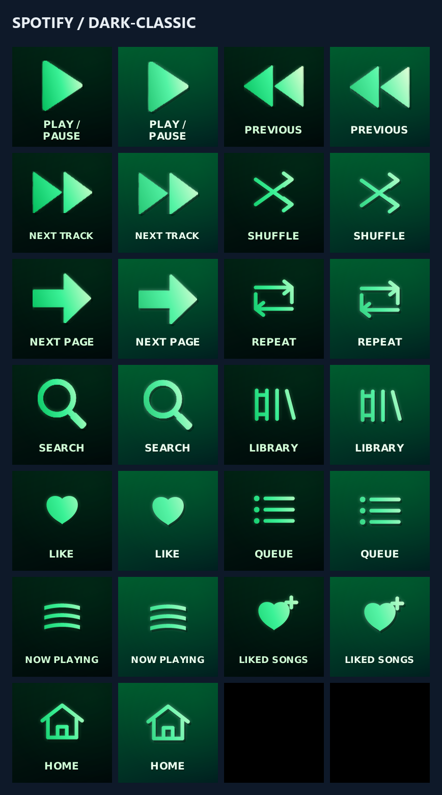

<!-- VBWR B
Project: UlanziDock VibeWare version
Repository: https://github.com/umbertotechnopreneur/ulanzi-dock-vibeware
Creator: Umberto Giacobbi | https://umbertogiacobbi.biz
VibeWare is Human intent, AI execution, and plenty of tokens
Manifesto: https://umbertogiacobbi.biz/vibeware/manifesto
AI Tooling: May include OpenAI Codex, GitHub Copilot and AI-assisted CI/CD pipelines.
AI Versions: Tools and models may vary by contributor and execution environment.
AI Traceability: Refer to Git history and CI/CD logs for recorded provenance.
Copyright (c) 2026 Umberto Giacobbi
SPDX-License-Identifier: MIT
License: MIT - see LICENSE
Required by the MIT License: retain the copyright and permission notice in all copies or substantial portions of the Software.
VBWR E -->

# UlanziDock VibeWare version

Your shortcuts, music and favourite apps, one button away.

## Why I built it

I am [Umberto Giacobbi](https://umbertogiacobbi.biz). I made this as a weekend project for my own desk.

I bought a **Ulanzi D200H** and wanted to change a few button pictures without running a huge app. So I built a small controller in Rust. Pick a theme, set your shortcuts and get on with your day.



*These desk photos were enhanced with AI.*

## What it does

- Ten pages: Windows / media, Utility, Codex, VS Code, Spotify, Word, PowerPoint, Excel, OBS Creator and Themes.
- Thirteen themes, with different colors and button styles.
- On Windows, optional page switching to follow the app you are using.
- Optional dimming of buttons when their app is not active. Turn pages off without losing their shortcuts.
- A clock or a large page-and-theme status display.
- No Node.js or browser runtime. No vendor app or custom driver required.

The code is free to use, change and share under the [MIT License](LICENSE).

<table>
  <tr><th>Windows / media</th><th>Spotify</th></tr>
  <tr>
    <td width="50%"></td>
    <td width="50%"></td>
  </tr>
</table>

*Button artwork in the MATRIX theme.*

## Get it running

Download the right package from [Releases](https://github.com/umbertotechnopreneur/ulanzi-dock-vibeware/releases). Extract the whole archive into a writable folder. On Windows, open `ulanzi-dock-vibeware.exe`. Keep the launcher beside it if you want startup at sign-in.

Linux and macOS use `./ulanzi-dock-vibeware run`. See [package notes](docs/RELEASING.md) for requirements.

Want an installer and a Start-menu entry? See [MSIX installation](docs/INSTALLATION.md). Want to build or change the app? See [the source and Codex guide](docs/DEVELOPMENT.md).

## Change your setup

On Windows, right-click the tray icon and choose **About → Configure**. Pick a theme, enable pages and choose whether the dock follows the active app. Click **Save + Restart**.

The settings buttons open `settings.json` and `applications.yaml` to edit shortcuts and app names. Office shortcuts start with US English defaults; change them for your keyboard if needed.

App detection, automatic switching and their interval are in `settings.json`, under `runtime`. The YAML only lists applications.

Old settings are not converted. Keep a backup, run `init --config new-settings.json` and copy across the shortcuts you want. Use the current `applications.yaml` too; it no longer has a `runtime` section.

To show the page and theme instead of the clock:

```powershell
.\ulanzi-dock-vibeware.exe run --status-display
```

Run `ulanzi-dock-vibeware help` for more commands.

### Brightness

Use **BRIGHT +** and **BRIGHT -** on the Utility page, or save a level from 0 to 100:

```powershell
.\ulanzi-dock-vibeware.exe brightness 50
```

The controller picks up the saved level while running. If it is closed, the level is used next time. The default is 100%. If you run with a custom settings file, pass the same `--config` path to this command.

At the minimum or maximum, the matching button shows UNAVAILABLE. I have not yet checked brightness on my physical dock.

### Jump to a page

At startup and on page changes, the dock starts with a black screen and reveals buttons from left to right, top to bottom. Each button uses three fade steps over a nominal 50 ms, with starts spaced about 8.3 ms apart. The full reveal targets 150 ms, plus USB and device processing time. The wide panel returns after the buttons. Presses received during the transition are discarded.

I have not yet checked the animation or its timing on my physical D200H.

Press the wide bottom display to open the page index, then choose a page. Disabled pages cannot be selected. Automatic switching pauses while this menu is open. NEXT PAGE still cycles through the regular pages.

I have not yet checked the new page-index buttons on my physical dock.

### OBS recording page

New settings include OBS Creator before Themes. The [OBS Creator guide](presets/obs-creator/README.md) explains how to add it to existing settings and how to configure the matching OBS hotkeys. Its recording, scene and audio buttons use all thirteen themes. There is also a [quick-start PDF](docs/obs-creator-quick-start.pdf).


*Artwork preview, not a dock photo. Buttons do not show live OBS status. I have not yet tried this page with the dock and OBS.*

## A future Windows editor

I am planning a WinUI 3 app for editing keys, pages, apps, themes, presets and device settings. It includes simple Hue and Saturation sliders.

[See the twelve dark/light mockups](docs/design/README.md). They are pictures of an idea, not a working interface. The current dialogs use Slint.

## Which hardware works?

I have tested only my **Ulanzi D200H**. It is the only model I own.

Have another model? [Build the source](docs/DEVELOPMENT.md), try it and [tell me what works or fails](https://github.com/umbertotechnopreneur/ulanzi-dock-vibeware/issues). Include your model and operating system. It might work, but I cannot promise it: the code currently detects the D200H specifically.

On Windows x64, button events, the clock, regular page navigation and the status display have been checked. Office pages and automatic switching still need a dock check. ARM64, Linux and macOS device behavior is unverified.

## Credits

Protocol references: [OpenActionMirrors D200](https://github.com/OpenActionMirrors/com.glmagalhaes.ulanzi.d200) and [independent D200 research](https://github.com/marcelobrake/ulanzi-linux/blob/main/docs/protocol.md). I wrote this as an independent MIT project. See [artwork notes](docs/ARTWORK.md) and [third-party licenses](docs/THIRD-PARTY.md).

Copyright © 2026 Umberto Giacobbi. [MIT License](LICENSE).

---

<p align="right">
  <a href="https://umbertogiacobbi.biz/vibeware/manifesto">
    
  </a><br>
  <strong>VibeWare</strong><br>
  <em>Human intent, AI execution, and plenty of tokens</em>
</p>

### This is VibeWare · [Manifesto](https://umbertogiacobbi.biz/vibeware/manifesto)

I built UlanziDock with AI help. I guide the work and am responsible for the result.

I started VibeWare for people making useful software with AI. Want to know more? [Read my manifesto](https://umbertogiacobbi.biz/vibeware/manifesto).

[UlanziDock on GitHub](https://github.com/umbertotechnopreneur/ulanzi-dock-vibeware) · [VibeWare on GitHub](https://github.com/umbertotechnopreneur/VibeWare) · [umbertogiacobbi.biz](https://umbertogiacobbi.biz)

[Terms](https://umbertogiacobbi.biz/terms/) · [Privacy](https://umbertogiacobbi.biz/privacy/)

## External dependency security policy

Before importing any third-party library or prebuilt binary into this
repository or its deliverables, including files supplied without source code,
run an explicit targeted Microsoft Windows Defender scan of the downloaded
package/archive and all extracted files and required dependencies that will be
used. Keep them staged until the scan finishes; real-time protection alone is
not enough.

Proceed only after the scan completes without detections. Record the official
source, version or SHA-256, scan command and result. An unavailable, disabled,
failed or unfinished scan, or any detection, blocks import. Do not bypass a
detection with exclusions, allowlisting, restored quarantine items or disabled
protection without separate explicit owner approval.

This rule applies to future imports; it does not certify existing dependencies.
