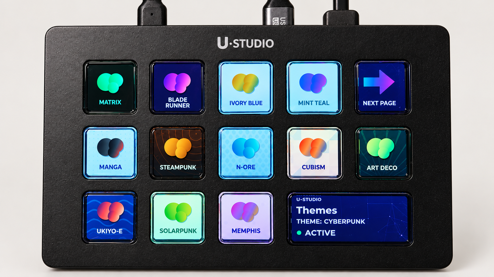
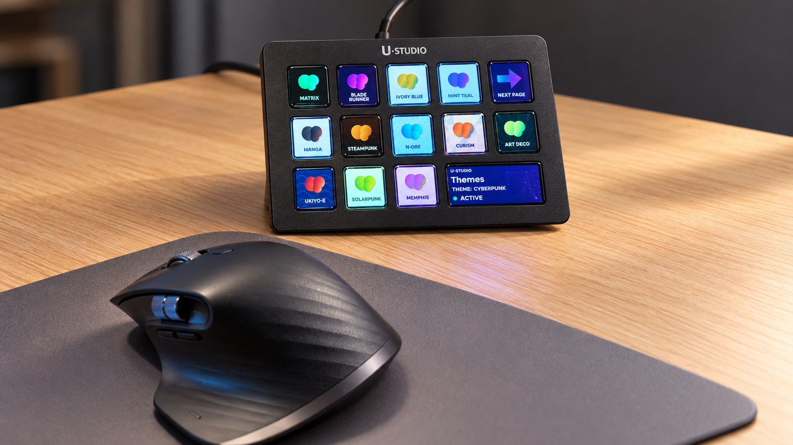

<!-- VBWR B

Project: UlanziDeck
Repository: https://github.com/umbertotechnopreneur/ulanzi-dock-vibeware
Creator: Umberto Giacobbi | https://umbertogiacobbi.biz

VibeWare: Human intent, AI execution, and plenty of tokens
Manifesto: https://umbertogiacobbi.biz/vibeware/manifesto

Modified with AI: OpenAI Codex; documentation and VibeWare attribution; 2026-10-27
Human guidance: Umberto Giacobbi; AGENTS.md; readability and VibeWare template request
Evidence: docs/CODE-REVIEW.md and current working-tree changes

Copyright (c) 2026 Umberto Giacobbi
SPDX-License-Identifier: MIT
License: MIT - see LICENSE
Required by the MIT License: retain the copyright and permission notice in all copies or substantial portions of the Software.

VBWR E -->





# UlanziDeck

[](https://github.com/umbertotechnopreneur/ulanzi-dock-vibeware/actions/workflows/build.yml)

[](LICENSE)

Your shortcuts, music and favourite apps, one button away.

## Quick-start PDFs

- **[Artwork atlas PDF](docs/ulanzi-dock-vibeware-guide-v2.pdf)** — the archived six-page design set; see the current setup guide below.
- **[OBS Creator Quick Start PDF](docs/obs-creator-quick-start.pdf)** — set up the OBS page and its shortcuts.

## Why I built it

I am [Umberto Giacobbi](https://umbertogiacobbi.biz). I made this as a weekend project for my own desk.

I bought a **Ulanzi D200H** and wanted to change a few button pictures without running a huge app. So I built a small controller in Rust, a language that compiles into a fast program without a browser runtime. Pick a theme, set your shortcuts and get on with your day.

This is an independent, unofficial project. I do not work for Ulanzi, and I am not affiliated with or sponsored by Ulanzi. Ulanzi does not endorse this project. All trademarks and registered trademarks belong to their respective owners.


*These desk photos were enhanced with AI.*

## What it does

- Ten pages: Windows / media, Utility, Codex, VS Code, Spotify, Word, PowerPoint, Excel, OBS Creator and Themes.
- Thirteen themes, with different colors and button styles.
- On Windows, optional page switching to follow the app you are using.
- Optional dimming of buttons when their app is not active. Turn pages off without losing their shortcuts.
- A clock or a large page-and-theme status display.
- No Node.js or browser runtime. No vendor app or custom driver required.

The code is free to use, change and share under the [MIT License](LICENSE).

<table>
  <tr><th>Windows / media</th><th>Spotify</th></tr>
  <tr>
    <td width="50%"></td>
    <td width="50%"></td>
  </tr>
</table>

*Button artwork in the MATRIX theme.*

## Get it running

Download the right package from [Releases](https://github.com/umbertotechnopreneur/ulanzi-dock-vibeware/releases). Extract the whole archive into a writable folder. On Windows, open `ulanzi-dock-vibeware.exe`. Keep the launcher beside it for startup at sign-in.

Linux and macOS Apple Silicon use `./ulanzi-dock-vibeware run`. Features differ by system; see [Windows, Linux and macOS](docs/PLATFORMS.md).

Want an installer and a Start-menu entry? See [installation and settings](docs/INSTALLATION.md). Want to build or change the app? See [development and the tools menu](docs/DEVELOPMENT.md). [All guides](docs/README.md) lists the other topics.

## Change your setup

On Windows, right-click the tray icon near the Windows clock and choose **About → Configure**. Pick a theme, enable pages and choose whether the dock follows the active app. Click **Save + Restart**.

The settings buttons open the files for shortcuts and app assignments. See [settings and backups](docs/INSTALLATION.md#change-and-back-up-settings) for their locations and what to edit.

To show the page and theme instead of the clock:

```powershell
.\ulanzi-dock-vibeware.exe run --status-display
```

Run `ulanzi-dock-vibeware help` for more commands.

### Brightness

Use **BRIGHT +** and **BRIGHT -** on the Utility page, or save a level from 0 to 100:

```powershell
.\ulanzi-dock-vibeware.exe brightness 50
```

The controller picks up the saved level while running. If it is closed, the level is used next time. The default is 100%. If you run with a custom settings file, pass the same `--config` path to this command.

At the minimum or maximum, the matching button shows UNAVAILABLE.

### Jump to a page

At the first dock connection, the UlanziDeck and VibeWare picture appears immediately and stays fully visible for at least two seconds. It then fades to black over one more second, and the last enabled page and saved theme return. The artwork compensates for the two physical gaps between the three display rows. If the saved page was removed or disabled, the normal home page opens instead. The page index itself is never remembered.

On page changes, buttons fade in from left to right, top to bottom. The animation targets 100 ms in total; USB and device processing can add time. Button pictures are kept in a bounded memory cache for reuse, and overdue animation updates are combined. The wide panel returns after the buttons. Presses during a transition are discarded.

When the app closes normally, the current dock screen fades to black over one second. This does not change the saved brightness. A forced termination, crash or USB disconnection cannot guarantee the closing animation.

Press the wide bottom display to open the page index, then choose a page. Disabled pages cannot be selected. Automatic switching pauses while this menu is open. NEXT PAGE still cycles through the regular pages.

### OBS recording page

New settings include OBS Creator before Themes. The [OBS Creator guide](presets/obs-creator/README.md) explains how to add it to existing settings and how to configure the matching OBS hotkeys. Its recording, scene and audio buttons use all thirteen themes. There is also a [quick-start PDF](docs/obs-creator-quick-start.pdf).


*Artwork preview, not a dock photo. Buttons do not show live OBS status.*

## A future Windows editor

I am planning a WinUI 3 app for editing keys, pages, apps, themes, presets and device settings. It includes simple Hue and Saturation sliders.

[See the twelve dark/light mockups](docs/design/README.md). They are pictures of an idea, not a working interface. The current dialogs use Slint.

## Which hardware works?

> [!IMPORTANT]
> **Windows on ARM testers wanted — volunteer guinea pigs welcome! 🐹**
>
> This is my hobby project, built for my own **Ulanzi D200H on Windows x64**. If you can try the **Windows ARM64**, **Linux x64** or **macOS Apple Silicon** build, I'd love your help checking USB connection, button images and presses, page switching, brightness and shortcuts. I'll give you all the support I can.
>
> Own another Ulanzi model? You're welcome too. The controller currently detects the D200H specifically, so other models may need code changes before they can connect. You can [build the source](docs/DEVELOPMENT.md) and help me find out what needs changing.
>
> [Open an issue](https://github.com/umbertotechnopreneur/ulanzi-dock-vibeware/issues) and tell me your dock model, operating system, CPU architecture, and what worked or failed.

## Credits

Protocol references: [OpenActionMirrors D200](https://github.com/OpenActionMirrors/com.glmagalhaes.ulanzi.d200) and [independent D200 research](https://github.com/marcelobrake/ulanzi-linux/blob/main/docs/protocol.md). I wrote this as an independent MIT project. See [artwork notes](docs/ARTWORK.md) and [third-party licenses](docs/THIRD-PARTY.md).

Copyright © 2026 Umberto Giacobbi. [MIT License](LICENSE).

## A note on security

Before adding an external library or binary, I require a targeted Microsoft Windows Defender scan of the downloaded archive and extracted files. New imports stay aside until the scan finishes without detections; I record the source and result. See [development](docs/DEVELOPMENT.md) for the first-import rule.

---

<p align="right">
  <a href="https://umbertogiacobbi.biz/vibeware/manifesto">
    
  </a><br>
  <strong>VibeWare</strong><br>
  <em>Human intent, AI execution, and plenty of tokens</em>
</p>

### This is VibeWare · [Manifesto](https://umbertogiacobbi.biz/vibeware/manifesto)

This project participates in the **VibeWare initiative**, an open initiative for developers who build useful software with AI under human direction. VibeWare describes participation in the initiative; it is not the application's author or publisher.

I am [Umberto Giacobbi](https://umbertogiacobbi.biz). I define this project's purpose, guide its implementation, and remain responsible for checking functionality, performance, and security. Each project keeps its own identity, license, release status and validation evidence.

To learn what VibeWare means and why I created it, read the [VibeWare manifesto](https://umbertogiacobbi.biz/vibeware/manifesto).

[UlanziDeck on GitHub](https://github.com/umbertotechnopreneur/ulanzi-dock-vibeware) · [VibeWare on GitHub](https://github.com/umbertotechnopreneur/VibeWare) · [umbertogiacobbi.biz](https://umbertogiacobbi.biz)

*You are welcome to explore, adapt and reuse the open-source VibeWare materials under the project license — my contribution to the developer community.*

[Terms](https://umbertogiacobbi.biz/terms/) · [Privacy](https://umbertogiacobbi.biz/privacy/)
