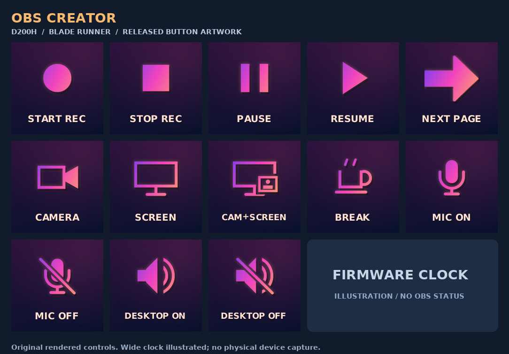

<!-- VBWR B
Project: UlanziDock VibeWare version
Repository: https://github.com/umbertotechnopreneur/ulanzi-dock-vibeware
Creator: Umberto Giacobbi | https://umbertogiacobbi.biz
VibeWare is Human intent, AI execution, and plenty of tokens
Manifesto: https://umbertogiacobbi.biz/vibeware/manifesto
AI Tooling: May include OpenAI Codex, GitHub Copilot and AI-assisted CI/CD pipelines.
AI Versions: Tools and models may vary by contributor and execution environment.
AI Traceability: Refer to Git history and CI/CD logs for recorded provenance.
Copyright (c) 2026 Umberto Giacobbi
SPDX-License-Identifier: MIT
License: MIT - see LICENSE
Required by the MIT License: retain the copyright and permission notice in all copies or substantial portions of the Software.
VBWR E -->

# OBS Creator

A page for recording with OBS: start, stop, pause, resume, four scenes, and microphone/desktop audio buttons. New settings include it by default. It works with all thirteen themes.

[Quick-start PDF](../../docs/obs-creator-quick-start.pdf)



*Artwork preview, not a dock photo. The clock is illustrated.*

Use a current build with OBS icon support. Older releases may not draw these buttons. This page sends hotkeys, not commands over an OBS connection. It shows no live recording or mute status. I have not yet tried it with the dock and OBS.

## Add the page

Existing settings need the page added once. Close UlanziDock and find the `settings.json` it uses. Start the app once first if the file does not exist.
2. From the repository folder, run this in PowerShell 7 with your actual settings path:

   ```powershell
   .\presets\obs-creator\install-preset.ps1 -SettingsPath 'C:\path\to\UlanziDock\settings.json'
   ```

   The script makes a backup and prints its path. It keeps your other pages and shortcuts, and adds OBS Creator before Themes. It stops on invalid settings or duplicate page names. To replace an existing OBS Creator page, add `-Replace`; this also replaces that page's custom shortcuts.

3. Start the updated app. Open **About → Configure**, keep app detection on and turn automatic page switching off. Choose **Save + Restart**. This keeps the OBS page visible while you use another app.
4. Press **NEXT PAGE** until OBS Creator appears. It stays available outside OBS.

To undo this, close the app and restore the printed backup. Automatic switching is saved in `settings.json` under `runtime`; check it in Configure after restoring the file.

`page.json` contains one page. Do not use it to replace your whole settings file. The installer does not start the app or change `applications.yaml`.

## Set up OBS

Create these scenes:

| Name | What to show |
| --- | --- |
| `01 CAMERA` | Your webcam. |
| `02 SCREEN` | The app or screen you want to record. |
| `03 CAM+SCREEN` | Screen plus a small webcam view. |
| `04 BREAK` | A "Back in a moment" screen. |

Use **Add Existing** when reusing a camera or screen source. In **Settings → Audio**, choose your microphone and desktop output once. Capturing the same audio twice can cause an echo.

Set **Settings → Advanced → Hotkeys → Hotkey Focus Behavior** to **Never disable hotkeys**. Leave **Studio Mode off** for direct scene changes. Pause needs a separate recording encoder, not **Same as stream** or **Use stream encoder**.

In **Settings → Hotkeys**, assign these keys. Every shortcut starts with **Ctrl + Shift + Alt**. They are my choices, not OBS defaults; remove conflicts.

| Dock button | Last key | OBS action |
| --- | --- | --- |
| START REC | `1` | Start Recording |
| STOP REC | `2` | Stop Recording |
| PAUSE | `3` | Pause Recording |
| RESUME | `4` | Unpause Recording |
| CAMERA | `5` | Switch to 01 CAMERA |
| SCREEN | `6` | Switch to 02 SCREEN |
| CAM+SCREEN | `7` | Switch to 03 CAM+SCREEN |
| BREAK | `8` | Switch to 04 BREAK |
| MIC ON | `9` | Microphone source: Unmute |
| MIC OFF | `0` | Microphone source: Mute |
| DESKTOP ON | `F5` | Desktop audio source: Unmute |
| DESKTOP OFF | `F7` | Desktop audio source: Mute |

Assign mute/unmute to the audio sources you actually use. NEXT PAGE and the clock need no OBS hotkeys.

BREAK only changes the scene. It does not pause or mute anything. For a private break, also pause or mute, and check OBS.

Before a full recording, make a short clip and play it back. Check the picture, microphone, scene changes, pause and mute.

[OBS quick start](https://obsproject.com/kb/quick-start-guide) · [Recording setup](https://obsproject.com/kb/standard-recording-output-guide)

## Rebuild the pictures and PDF

Build the current source with `cargo build --release --locked`. Use its executable, not an older installed copy, and pass your settings path with `--config` when using the preset.

To recreate the pictures, use a fresh temporary settings file. These commands create files without opening the dock or sending shortcuts. You also need Python, Pillow and ReportLab.

```powershell
New-Item -ItemType Directory -Force tmp/obs-creator | Out-Null
.\target\release\ulanzi-dock-vibeware.exe init --config tmp/obs-creator/settings.json
.\presets\obs-creator\install-preset.ps1 -SettingsPath tmp/obs-creator/settings.json
.\target\release\ulanzi-dock-vibeware.exe render --config tmp/obs-creator/settings.json --output tmp/obs-creator/artwork --page 9
python docs/build_obs_guide.py
```

`init` will not overwrite an existing file. In this fresh setup, OBS Creator is page 9 and Themes is page 10. The export makes both button states in all thirteen themes. The builder writes `preview.png` here and the PDF in `docs/`.

The Windows x64 build, artwork export and PDF review were completed. No live-settings installation, automated tests, OBS session or dock trial was run for this preset.

I made this as [Umberto Giacobbi](https://umbertogiacobbi.biz). **VibeWare is Human intent, AI execution, and plenty of tokens.** [Manifesto](https://umbertogiacobbi.biz/vibeware/manifesto).
